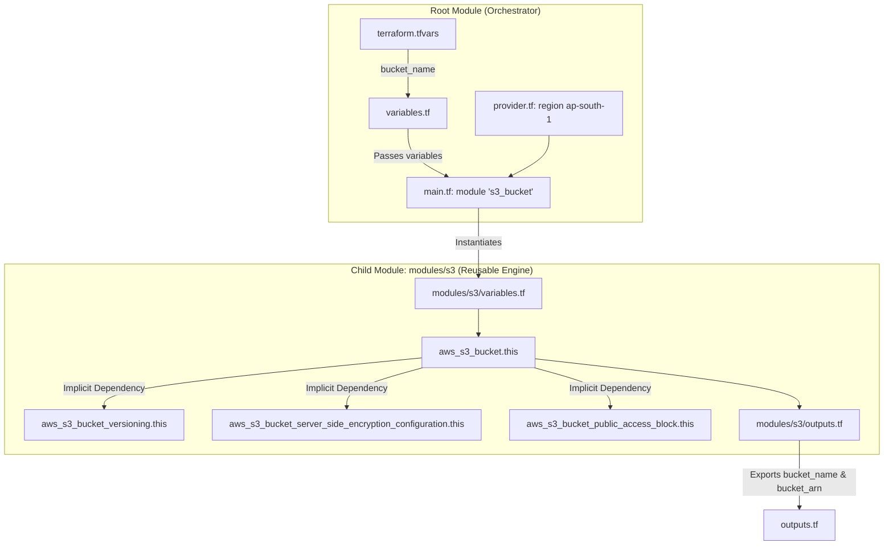

# Reusable AWS S3 Bucket Terraform Module

A production-ready, modular Terraform project demonstrating how to build, configure, and consume a reusable AWS S3 module adhering to AWS security best practices.

---

## 📌 Project Overview & Objectives

The primary objective of this project is to implement an enterprise-grade Infrastructure as Code (IaC) pattern in Terraform using a reusable child module architecture.

Instead of hardcoding resource blocks directly in the root configuration, this project encapsulates S3 bucket creation and hardening logic into a standalone, version-controlled module (`modules/s3`), making it reusable across environments (Dev, Staging, Prod) and multiple workloads.

### Key Highlights:
- **Modular Design:** Decoupled root orchestration and reusable child module logic.
- **Security-First Architecture:** Versioning enabled, AES256 default server-side encryption, and strict block on all public access.
- **Provider & Version Locking:** Pinned AWS provider (`~> 5.0`) with child module compatibility (`>= 4.0.0`).
- **Dry-Run Validated:** Completely tested and plan-verified (`4 to add, 0 to change, 0 to destroy`) without making live AWS changes.

---

## 💡 Why Reusable Terraform Modules?

1. **DRY Principle (Don't Repeat Yourself):** Avoids copy-pasting 30-50 lines of S3 configuration across multiple environments.
2. **Centralized Security & Governance:** Security baselines (e.g., encryption, public access block) are enforced in one place. Any consumer using the module automatically gets compliant infrastructure.
3. **Maintainability:** Updates or standard changes are made once in the child module, propagating cleanly to all callers.
4. **Separation of Concerns:** The child module defines *how* an S3 bucket is safely built; the root module defines *what* inputs (bucket name, region, tags) to supply for a given deployment.

---

## 📂 Project Structure

```text
terraform-s3-module/
│
├── .gitignore                  # Prevents secrets, state files, and cache from entering Git
├── .terraform.lock.hcl         # Dependency lock file pinning exact provider versions
├── provider.tf                 # Terraform engine settings and AWS provider configuration
├── variables.tf                # Root module input variable declarations and defaults
├── terraform.tfvars            # Local variable assignments (excluded from Git)
├── terraform.tfvars.example    # Public template showing variable usage without secrets
├── main.tf                     # Root caller instantiating the child module
├── outputs.tf                  # Root-level outputs surfacing module attributes
├── README.md                   # Complete architectural and operational documentation
│
└── modules/
    └── s3/                     # Self-contained Reusable Child Module
        ├── versions.tf         # Minimum Terraform & AWS provider constraints for the module
        ├── variables.tf        # Input variable definitions required by the module
        ├── main.tf             # Core AWS S3 resources (Bucket, Versioning, SSE, Public Access)
        └── outputs.tf          # Module outputs exported back to the calling root
```

---

## 🏗️ Architecture: Root Module vs Child Module



### 1. Root Module (`/`)
- Acts as the environment orchestrator.
- Configures the AWS provider region (`ap-south-1`).
- Supplies environment-specific variable values (`bucket_name`, `tags`) via `terraform.tfvars`.
- Calls `module "s3_bucket"` and exposes final outputs (`bucket_name`, `bucket_arn`) to the terminal.

### 2. Child Module (`modules/s3/`)
- Independent, generic, and agnostic to any single environment.
- Takes `bucket_name` and `tags` as required inputs (with no hardcoded bucket name defaults).
- Provisions the four standard S3 resources using modern decoupled AWS Provider v5 syntax.

---

## 🛡️ S3 Resources & Security Configuration

The child module provisions four decoupled AWS resources:

### 1. `aws_s3_bucket.this`
- **Purpose:** Creates the core S3 storage container.
- **Attributes:** Configured with `bucket = var.bucket_name` and metadata tags for cost attribution and governance.

### 2. `aws_s3_bucket_versioning.this`
- **Purpose:** Protects against accidental overwrites and deletions.
- **Setting:** `versioning_configuration { status = "Enabled" }`.
- **Benefit:** Every version of every object is retained, allowing restoration in case of unintended modification or ransomware incidents.

### 3. `aws_s3_bucket_server_side_encryption_configuration.this`
- **Purpose:** Enforces mandatory encryption-at-rest.
- **Setting:** `apply_server_side_encryption_by_default { sse_algorithm = "AES256" }`.
- **Benefit:** Uses AWS managed keys (SSE-S3 / AES256) at zero additional KMS key management cost while satisfying enterprise regulatory and compliance baselines.

### 4. `aws_s3_bucket_public_access_block.this`
- **Purpose:** Completely prevents data exposure to the public internet.
- **Settings:**
  - `block_public_acls = true` (blocks new public ACLs)
  - `block_public_policy = true` (rejects bucket policies allowing public access)
  - `ignore_public_acls = true` (ignores all existing public ACLs on the bucket and its objects)
  - `restrict_public_buckets = true` (restricts bucket access only to AWS service principals and authorized users)

> **Resource Dependency Note:**
> All three companion resources reference `bucket = aws_s3_bucket.this.id`. This establishes an **implicit dependency** in Terraform's Directed Acyclic Graph (DAG), ensuring the bucket is provisioned before applying security policies.

---

## ⚙️ Inputs & Outputs

### Input Variables (Root)

| Variable | Description | Type | Default | Required? |
| :--- | :--- | :--- | :--- | :---: |
| `aws_region` | AWS region where the bucket will be provisioned | `string` | `"ap-south-1"` | No |
| `bucket_name` | Globally unique S3 bucket name | `string` | `"my-practical-tf-s3-bucket-demo"` | Yes (Override via `.tfvars`) |
| `tags` | Map of resource tags applied for billing & tracking | `map(string)` | `Environment: Dev`, `Project: ...`, `ManagedBy: Terraform` | No |

### Child Module Inputs (`modules/s3/variables.tf`)

| Variable | Description | Type | Default |
| :--- | :--- | :--- | :--- |
| `bucket_name` | Name of the bucket to create (no fallback) | `string` | *(None — must be supplied)* |
| `tags` | Resource tags | `map(string)` | `{}` |

### Outputs

| Output Name | Description | Source |
| :--- | :--- | :--- |
| `bucket_name` | The final created S3 bucket name / ID | `module.s3_bucket.bucket_name` |
| `bucket_arn` | The Amazon Resource Name (ARN) of the bucket | `module.s3_bucket.bucket_arn` |

---

## 📋 Prerequisites

Before running this project, ensure you have:
1. **Terraform CLI:** Version `1.0.0` or higher (verified with `1.15.x`).
2. **AWS CLI:** Version 2.x installed and configured (`aws configure`).
3. **AWS IAM Permissions:** Active credentials with permissions to manage S3 (`s3:CreateBucket`, `s3:PutBucketVersioning`, `s3:PutEncryptionConfiguration`, `s3:PutBucketPublicAccessBlock`).

---

## 🚀 Execution & Verification Workflow

```powershell
# 1. Initialize working directory & download AWS provider
terraform init

# 2. Check and enforce consistent formatting across all folders
terraform fmt -check -recursive

# 3. Validate syntax and configuration integrity
terraform validate

# 4. Preview execution plan (Dry Run - No resources created)
terraform plan
```

### Applying and Destroying (When Ready for Real Deployment)

> [!WARNING]
> Running `terraform apply` provisions real cloud infrastructure in AWS and initiates billable resources. Do not run unless instructed.

```powershell
# To provision resources in AWS:
terraform apply

# To tear down and delete resources when done:
terraform destroy
```

---

## 📊 Plan Verification Summary

A dry-run plan was executed with the following result:

```text
Plan: 4 to add, 0 to change, 0 to destroy.

Changes to Outputs:
  + bucket_arn  = (known after apply)
  + bucket_name = (known after apply)
```

> [!IMPORTANT]
> **Status Notice:**
> This configuration has been **syntax-validated and plan-tested** successfully. Actual AWS deployment (`terraform apply`) has **NOT** been performed, and no resources currently exist in AWS.
> 
> **S3 Namespace Notice:**
> A successful `terraform plan` confirms that your HCL syntax, provider schemas, and variable references are valid. It **does not guarantee** that the bucket name is available in the global AWS namespace. AWS only verifies bucket name availability during actual creation or through an explicit API check.

---

## 💰 AWS Cost Considerations

- **S3 Bucket Creation:** Creating an S3 bucket itself carries no upfront fee.
- **Storage & Requests:** S3 pricing is based on GB/month of data stored, PUT/GET/LIST requests, and outbound data transfer.
- **Versioning Storage Impact:** When versioning is enabled, modifying or replacing an object stores both the old and new copies, increasing storage consumption over time. In production, an S3 Lifecycle rule should be configured to transition or delete old noncurrent versions after a set number of days.
- **AES256 Encryption:** Default SSE-S3 encryption is completely free of charge.

---

## 🔒 Security Best Practices & Git Hygiene

1. **Never Commit `.tfvars`:**
   Local `*.tfvars` files often contain account-specific values or sensitive parameters. They are strictly excluded via `.gitignore`.
2. **Never Commit Terraform State (`*.tfstate`):**
   State files contain sensitive metadata, resource IDs, and potentially unencrypted values. State files must be stored locally during testing or in a secure remote backend (e.g., S3 + DynamoDB state locking) in production.
3. **Commit `.terraform.lock.hcl`:**
   This file ensures that every member of the engineering team downloads the exact same checksum-verified provider binaries, eliminating "works on my machine" issues.
4. **Credential Isolation:**
   No AWS Access Keys or Secret Keys are hardcoded in any `.tf` file. Terraform securely reads credentials from the local AWS credential chain (`~/.aws/credentials` or environment variables).

