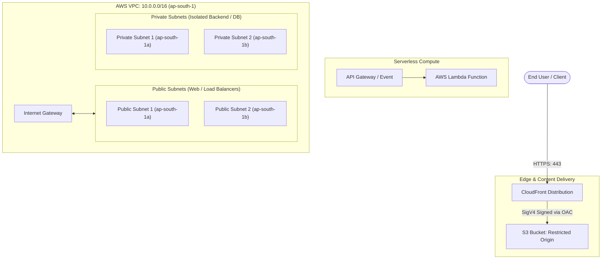

# Reusable AWS Terraform Modules (Production-Conscious IaC)

A modular, production-conscious Terraform repository containing four independent, reusable AWS infrastructure modules adhering to HashiCorp best practices and AWS Well-Architected Framework guidelines.

---

## 📌 Repository Overview & Objectives

This repository demonstrates how to architect, structure, and consume production-grade Infrastructure as Code (IaC) modules in AWS. Rather than hardcoding infrastructure into monolithic configurations, this repository isolates common cloud patterns into reusable components:

1. **S3 Bucket Module:** Secure object storage with mandatory versioning, AES256 server-side encryption, and strict public access blocking.
2. **VPC Network Module:** Multi-AZ Virtual Private Cloud with public and private subnets, an Internet Gateway, and decoupled route tables.
3. **Lambda Compute Module:** Configurable serverless compute engine supporting flexible runtimes, memory/timeout validations, and dynamic environment variables.
4. **CloudFront CDN Module:** Edge content distribution using an S3 REST origin secured with AWS Origin Access Control (OAC) and SigV4 request signing.

Each module is paired with an independent implementation in `examples/` demonstrating how calling modules source, configure, and consume module outputs.

---

## 📂 Repository Structure

```text
terraform-aws-modules/
│
├── .gitignore                  # Prevents secrets, state files, cache, and OS metadata from Git
├── .terraform.lock.hcl         # Root dependency lock file pinning exact provider binaries
├── provider.tf                 # Root AWS provider configuration (region: ap-south-1)
├── variables.tf                # Root variable definitions (region, bucket_name, tags)
├── terraform.tfvars            # Local demo variables (strictly excluded from Git)
├── terraform.tfvars.example    # Public variable template for external reviewers
├── main.tf                     # Root caller demonstrating the S3 child module
├── outputs.tf                  # Root-level outputs
├── README.md                   # Main repository documentation
│
├── modules/                    # Self-contained Reusable Child Modules
│   ├── s3/                     # S3 Module (Bucket, Versioning, SSE, Public Access Block)
│   │   ├── versions.tf
│   │   ├── variables.tf
│   │   ├── main.tf
│   │   └── outputs.tf
│   ├── vpc/                    # VPC Module (VPC, Multi-AZ Subnets, IGW, Route Tables)
│   │   ├── versions.tf
│   │   ├── variables.tf
│   │   ├── main.tf
│   │   └── outputs.tf
│   ├── lambda/                 # Lambda Module (Function, Handler, Runtime, Memory, Validation)
│   │   ├── versions.tf
│   │   ├── variables.tf
│   │   ├── main.tf
│   │   └── outputs.tf
│   └── cloudfront/             # CloudFront Module (OAC, SigV4, Cache Behavior, Security)
│       ├── versions.tf
│       ├── variables.tf
│       ├── main.tf
│       └── outputs.tf
│
└── examples/                   # Independent, Testable Example Implementations
    ├── vpc/                    # Example VPC implementation across 2 Availability Zones
    │   ├── provider.tf
    │   ├── variables.tf
    │   ├── main.tf
    │   ├── outputs.tf
    │   └── README.md
    ├── lambda/                 # Example Lambda function caller
    │   ├── provider.tf
    │   ├── variables.tf
    │   ├── main.tf
    │   ├── outputs.tf
    │   └── README.md
    └── cloudfront/             # Example CloudFront distribution with S3 OAC
        ├── provider.tf
        ├── variables.tf
        ├── main.tf
        ├── outputs.tf
        └── README.md
```

---

## 🏗️ Architecture & Component Flow



---

## 📦 Reusable Modules Specification

### 1. AWS S3 Module (`modules/s3`)
- **Key Resources:** `aws_s3_bucket`, `aws_s3_bucket_versioning`, `aws_s3_bucket_server_side_encryption_configuration`, `aws_s3_bucket_public_access_block`.
- **Security Baseline:**
  - Versioning enabled (`status = "Enabled"`).
  - Default server-side encryption via AES256 (SSE-S3) with zero key management overhead.
  - All four public access block settings set to `true`.
- **Inputs:** `bucket_name` (string, required), `tags` (map(string), optional).
- **Outputs:** `bucket_name` (ID of bucket), `bucket_arn` (ARN of bucket).

### 2. AWS VPC Module (`modules/vpc`)
- **Key Resources:** `aws_vpc`, `aws_subnet` (public/private count-based), `aws_internet_gateway`, `aws_route_table` (public/private), `aws_route_table_association`.
- **Inputs & Validation:**
  - `vpc_cidr`: String (default `"10.0.0.0/16"`, validated for IPv4 CIDR).
  - `availability_zones`: List of AZs (e.g. `["ap-south-1a", "ap-south-1b"]`).
  - `public_subnet_cidrs` & `private_subnet_cidrs`: List of CIDRs. Length is strictly validated to match the number of configured availability zones.
  - `enable_dns_hostnames` & `enable_dns_support`: Booleans (default `true`).
- **Cost-Conscious Architecture:** Private subnets are isolated with local VPC routing and **no NAT Gateway**, avoiding recurring idle NAT Gateway charges (~$32/month per AZ).
- **Outputs:** `vpc_id`, `vpc_cidr_block`, `public_subnet_ids`, `private_subnet_ids`, `internet_gateway_id`, `public_route_table_id`, `private_route_table_id`.

### 3. AWS Lambda Module (`modules/lambda`)
- **Key Resources:** `aws_lambda_function`.
- **Inputs & Validation:**
  - `function_name`: Validated via regex `^[a-zA-Z0-9-_]{1,64}$`.
  - `runtime`: Supported Lambda runtimes (default `"python3.11"`).
  - `handler`: Entrypoint handler (default `"index.handler"`).
  - `role_arn`: Validated via regex for AWS IAM role ARN format.
  - `filename`: Local filesystem path to the deployment ZIP package.
  - `timeout`: Validated between `1` and `900` seconds (default `3`).
  - `memory_size`: Validated between `128` and `10,240` MB (default `128`).
  - `environment_variables`: Map of strings rendered via dynamic blocks only when non-empty.
- **Outputs:** `function_name`, `arn`, `invoke_arn`, `qualified_arn`.

### 4. AWS CloudFront Module (`modules/cloudfront`)
- **Key Resources:** `aws_cloudfront_distribution`, `aws_cloudfront_origin_access_control`.
- **Origin & Security Configuration:**
  - Points to S3 REST endpoint domain name (NOT the legacy S3 website endpoint).
  - Uses modern **Origin Access Control (OAC)** with SigV4 signing protocol.
  - Default cache behavior enforces `redirect-to-https`, `allowed_methods = ["GET", "HEAD"]`, compression enabled (`compress = true`), and attaches to AWS Managed CachingOptimized policy.
  - Price class configurable (`PriceClass_100`, `PriceClass_200`, `PriceClass_All`).
- **Outputs:** `distribution_id`, `arn`, `domain_name`, `hosted_zone_id`, `status`, `origin_access_control_id`, `recommended_s3_bucket_policy`.

---

## 🚀 How to Consume Modules in Your Projects

Any external Terraform project can consume these modules using relative paths or Git source URLs:

```hcl
# Example: Consuming the VPC module
module "network" {
  source = "./modules/vpc" # or "github.com/<owner>/terraform-aws-modules//modules/vpc"

  vpc_cidr             = "10.0.0.0/16"
  vpc_name             = "production-vpc"
  availability_zones   = ["ap-south-1a", "ap-south-1b"]
  public_subnet_cidrs  = ["10.0.1.0/24", "10.0.2.0/24"]
  private_subnet_cidrs = ["10.0.11.0/24", "10.0.12.0/24"]

  tags = {
    Environment = "production"
    ManagedBy   = "Terraform"
  }
}
```

---

## 🧪 Verification & Testing Workflow

Each module example is independent and can be tested locally using standard Terraform commands:

```powershell
# 1. Navigate to the desired example directory:
cd examples/vpc          # or cd examples/lambda, cd examples/cloudfront

# 2. Initialize working directory & download AWS provider plugins:
terraform init

# 3. Check code formatting against standard style guidelines:
terraform fmt -check

# 4. Validate configuration syntax and schema rules:
terraform validate

# 5. Preview execution actions (Dry-Run Preview):
terraform plan -no-color
```

---

## ⚠️ Important Deployment Prerequisites

Before running `terraform apply` on any module in a live AWS environment:

1. **Lambda Deployment Package (ZIP):**
   AWS Lambda requires a physical ZIP file containing compiled code (e.g., `build/function.zip`). In accordance with repository cleanliness standards, compiled binary ZIP files are excluded from Git. See `examples/lambda/README.md` for packaging instructions.
2. **Lambda IAM Execution Role:**
   You must provide an existing IAM role ARN with `AWSLambdaBasicExecutionRole` permissions.
3. **CloudFront S3 Bucket Policy:**
   CloudFront OAC requires an explicit bucket policy on the origin S3 bucket allowing `s3:GetObject` with `"AWS:SourceArn": "<DISTRIBUTION_ARN>"`. To keep modules decoupled, the CloudFront module outputs this policy statement (`recommended_s3_bucket_policy`) for you to attach to your bucket.
4. **S3 Global Uniqueness:**
   S3 bucket names must be globally unique across all AWS accounts worldwide. A successful `terraform plan` confirms syntax validity but does not reserve the name in AWS.

---

## 💰 Cost & Security Warnings

- **Dry-Run Notice:** All configurations in this repository have been **syntax-validated and plan-tested**. Actual AWS deployment (`terraform apply`) has **NOT** been performed, and no cloud resources exist.
- **Billable Resources:** Running `terraform apply` on real AWS environments provisions billable infrastructure (e.g., S3 requests/storage, CloudFront data transfer, Lambda invocations). Always run `terraform destroy` when finished with temporary testing.
- **Credential Hygiene:** Never commit `.tfvars` files, state files (`*.tfstate`), PEM certificates, or AWS credentials to version control. The repository's `.gitignore` automatically blocks these patterns.

---

## 🔮 Future Improvements & Roadmap

- [ ] Add an optional NAT Gateway toggle in `modules/vpc` for private subnet egress when outbound internet access is required.
- [ ] Add AWS WAF (Web Application Firewall) integration option to `modules/cloudfront`.
- [ ] Add VPC configuration options (VPC endpoint / subnet IDs) to `modules/lambda` for database connectivity.
- [ ] Implement remote state management backend using S3 + DynamoDB state locking.
